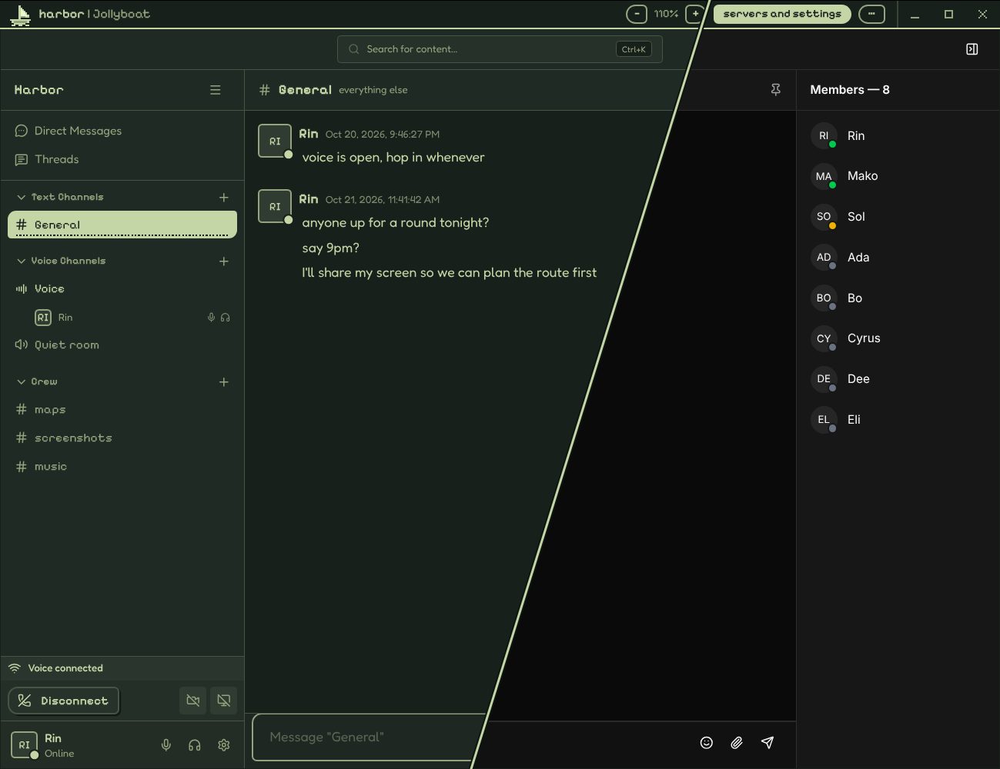
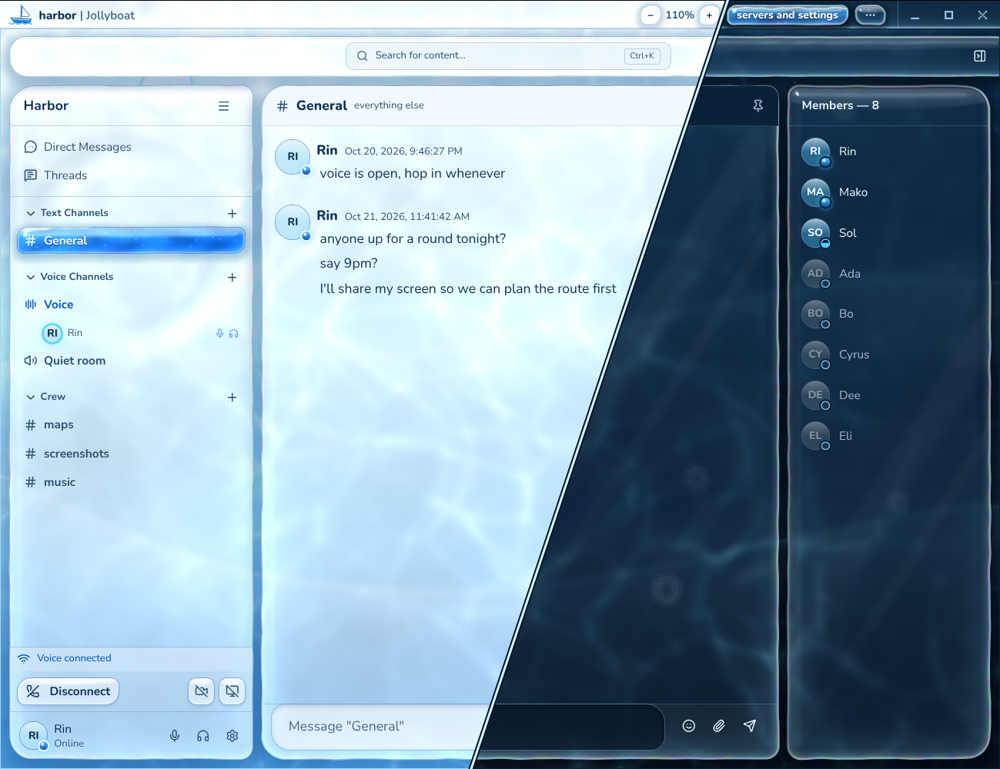
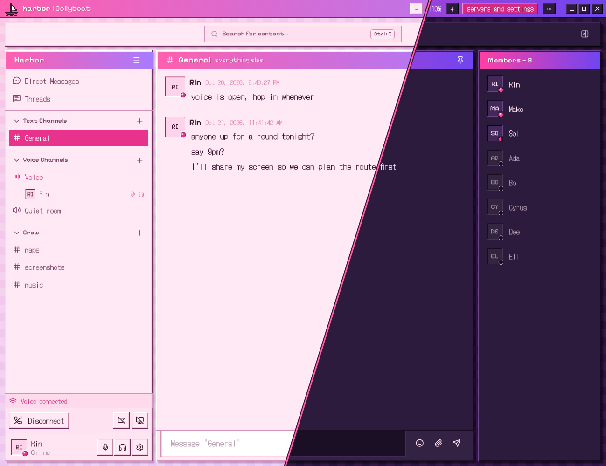

<p align="center"></p>

# Jollyboat

A desktop app for [Sharkord](https://sharkord.com) servers, for Windows and Linux on x64 and ARM (macOS experimental). It loads your server's own web app and adds what a browser tab can't: screen sharing with sound, global hotkeys, a tray, a voice overlay and themes. Not affiliated with Sharkord.



<sub>The Jollyboat theme (left) and Sharkord's own look (right), both dark.</sub>



<sub>The Water theme, light (left) and dark (right).</sub>



<sub>Retro in pink, light (left), and in green, dark (right).</sub>

## What it adds

**In a call**
- **Screen sharing with sound** — everything you hear except your own call. On Linux the share is encoded on the GPU when it can be.
- **Global hotkeys and push-to-talk** — mute, deafen and push-to-talk from any window. Set them in Sharkord's user settings (for push-to-talk, pick it as the mic mode). Works on Wayland too (KDE, GNOME 48+), where the desktop asks once.
- **Voice overlay** (optional) — who is in the call and who is talking, on top of your game or other apps, as see-through as you like. Clicks go through it; place it once with **set position**.
- **Pop-out stream** — a screen share or camera someone sends, in its own small always-on-top window (ctrl+shift+p, or the button in the bar).
- **Careful in calls** — asks before a reload or quit would drop you out of a call.

**Around it**
- **Tray** — shows when you are in voice, talking, muted or deafened, and when there are new messages; its icon matches your theme. Closing the window minimizes, hides to the tray or quits.
- **Servers** — several, with proxy logins (basic auth), staying logged in, one that opens at start, and share codes to pass them on.
- **Saving pictures and files** — a save button under pictures and videos, on file cards and in the full-screen picture, and a right-click menu (save or copy images and links, cut, copy, paste, spelling). The app saves them itself, so it works behind a proxy login, where another browser couldn't open them.
- **One bar on top** — server name, zoom (50 to 300 %, the bar grows with it), servers and settings, window buttons.
- **Light, dark or auto** — for everything: the Sharkord page, its bar, the overlay and the setup window.
- **Languages** — English, German and Polish.
- **Private** — talks to your servers, plus GitHub for update checks (one switch to turn off). No telemetry. On Windows, push-to-talk uses a keyboard hook while a hotkey is set: keys are compared with your hotkeys and never stored or sent.

## Themes

Pick one under **servers and settings**; Water and Retro come in a few colours, picked with the little squares beside the theme menu. The app's own windows (the bar above the page, the setup window, the overlay) follow along, in the lcd look, in glass with Water, or as old-desktop windows with Retro; each theme has its own tray icon.

- **Sharkord** — Sharkord as it is.
- **Jollyboat** — an lcd look: pixel type for headings, pill buttons, presence you can tell apart at a glance, a few stepped animations.
- **Water** — white and blue water under glass; or pink, or black and white (white water by day, black by night). Live water with caustics, ripples and air bubbles runs behind everything; the sidebars, the chat and the bar are frosted glass panels floating on it, the buttons glass bubbles whose water rises and leans toward the pointer, the channel you are on and the voice channel you are in pills of water that fill as you pick them. Sent messages drop into the water, and whoever talks sends rings across it. It runs at 60 frames a second while the window is in front and 30 behind; without hardware graphics it keeps a lighter version drawn in CSS.
- **Retro** — a nineties desktop, in pink, in mint and sky blue, or in the classic grey with navy title bars. The sidebars, the chat and the member list are windows with gradient title bars (pink to lilac, or green to blue) floating on a pastel desktop (deep purple or deep teal at night); buttons are bevelled, fields sunken, scrollbars the old kind, the type pixel type, and the channel you are on is picked out like a selected file. Whoever talks gets a blinking frame; menus open in a few steps, the way old desktops drew them.
- **Custom** — your own CSS for the Sharkord page, read again whenever the file changes.


## Install

From [releases](../../releases):

| | |
|---|---|
| Windows (x64 or ARM) | `Jollyboat-x.y.z-windows-universal-setup.exe`, or portable: `Jollyboat-x.y.z-windows-x64-portable.exe` (`arm64`), settings in a `Jollyboat-data` folder next to it |
| Linux (x64 or ARM) | `flatpak install ./Jollyboat-x.y.z-linux-x64.flatpak` (or `linux-arm64`) |
| macOS 13+ (**experimental**) | `Jollyboat-x.y.z-mac-universal-EXPERIMENTAL.dmg` |

Add your server's address; if a proxy asks for a login first, tick **proxy login / basic auth**. On a server, **servers and settings** in the top bar (or ctrl+shift+s) opens the settings again.

Tip: for GPU-encoded screen shares, pick H264 (or AV1 on newer GPUs) as the screen codec in Sharkord's settings, with simulcast off.

### macOS is experimental

CI builds it and checks that it starts, but nobody on the project has used it on a real Mac. It
is not signed by Apple, so the first open needs **System Settings → Privacy & Security → Open
Anyway**. It does not update itself (it tells you about new releases), asks for permissions again
after each update, and screen-share sound may include your own call. Reports welcome.

## Build

```bash
npm install
npm run dev
npm run dist:win     # on Windows: the installer and both portable exes
npm run dist:linux   # the unpacked app; the flatpak is built from source:
                     # flatpak-builder --user --install build-dir flatpak/net.innovativefluid.Jollyboat.yml
npm run dist:mac     # on a mac (experimental)
python3 tools/make-icons.py   # the app and tray icons, from build/pixel/ (needs Pillow)
```

MIT — see [LICENSE](LICENSE) and [THIRD_PARTY_NOTICES.md](THIRD_PARTY_NOTICES.md).
