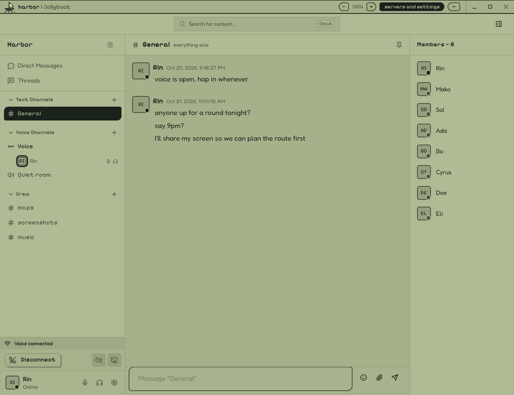
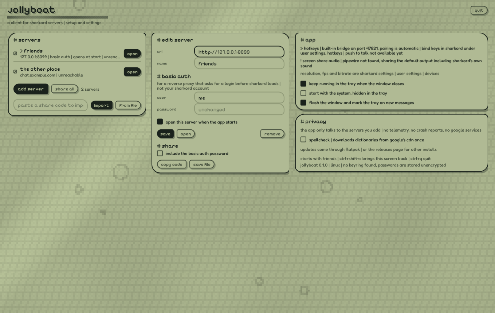

<p align="center"></p>

# Jollyboat

A desktop app for [Sharkord](https://sharkord.com) servers, for Windows and Linux on x64 and ARM (macOS experimental). Not affiliated with Sharkord.



<sub>The same server in both themes: Jollyboat's lcd look on the left, Sharkord's own on the right.</sub>

## What it adds

**In a call**
- **Screen sharing with sound** — everything you hear except your own call. On Linux the share is encoded on the GPU when it can be.
- **Global hotkeys and push-to-talk** — mute, deafen and push-to-talk from any window. Set them in Sharkord's user settings (for push-to-talk, pick it as the mic mode). Works on Wayland too (KDE, GNOME 48+), where the desktop asks once.
- **Voice overlay** (optional) — who is in the call and who is talking, on top of your game or other apps, as see-through as you like. Clicks go through it; place it once with **set position**.
- **Pop-out stream** — a screen share or camera someone sends, in its own small always-on-top window (ctrl+shift+p, or the button in the bar).
- **Careful in calls** — asks before a reload or quit would drop you out of a call.

**Around it**
- **Tray** — shows when you are in voice, talking, muted, deafened, and new messages. Closing the window minimizes, hides to the tray or quits.
- **Servers** — several, with proxy logins (basic auth), staying logged in, one that opens at start, and share codes to pass them on.
- **One bar on top** — server name, zoom (50 to 300 %, the bar grows with it), servers and settings, window buttons.
- **Light, dark or auto** — for everything: the Sharkord page, its bar, the overlay and the setup window.
- **Themes** — Sharkord as it is, the **Jollyboat** theme (above, with the setup window's pixel type, pill buttons and a few stepped animations), **Water** (white and blue water under glass, the setup window and the bar included: live water with caustics, ripples and air bubbles under refracting, frosted glass, bubble buttons, a glass boat on liquid waves; Sharkord's parts float on it as glass panels the water shows through, the channel you are on a pill of water), or your own CSS.
- **Languages** — English, German and Polish.
- **Private** — talks to your servers, plus GitHub for update checks (one switch to turn off). No telemetry. On Windows, push-to-talk uses a keyboard hook while a hotkey is set: keys are compared with your hotkeys and never stored or sent.



## Install

From [releases](../../releases):

| | |
|---|---|
| Windows (x64 or ARM) | `Jollyboat-x.y.z-windows-universal-setup.exe`, or portable: `Jollyboat-x.y.z-windows-x64-portable.exe` (`arm64`), settings in a `Jollyboat-data` folder next to it |
| Linux (x64 or ARM) | `flatpak install ./Jollyboat-x.y.z-linux-x64.flatpak` (or `linux-arm64`) |
| macOS 13+ (**experimental**) | `Jollyboat-x.y.z-mac-universal-EXPERIMENTAL.dmg` |

Add your server's address; if a proxy asks for a login first, tick **proxy login / basic auth**. On a server, **servers and settings** in the top bar (or ctrl+shift+s) opens the settings again.

Tip: for GPU-encoded screen shares, pick H264 (or AV1 on newer GPUs) as the screen codec in Sharkord's settings, with simulcast off.

### macOS is experimental

CI builds it and checks that it starts, but nobody on the project has used it on a real Mac. It
is not signed by Apple, so the first open needs **System Settings → Privacy & Security → Open
Anyway**. It does not update itself (it tells you about new releases), asks for permissions again
after each update, and screen-share sound may include your own call. Reports welcome.

## Build

```bash
npm install
npm run dev
npm run dist:win     # on Windows: the installer and both portable exes
npm run dist:linux   # the unpacked app; the flatpak is built from source:
                     # flatpak-builder --user --install build-dir flatpak/net.innovativefluid.Jollyboat.yml
npm run dist:mac     # on a mac (experimental)
```

MIT — see [LICENSE](LICENSE) and [THIRD_PARTY_NOTICES.md](THIRD_PARTY_NOTICES.md).
