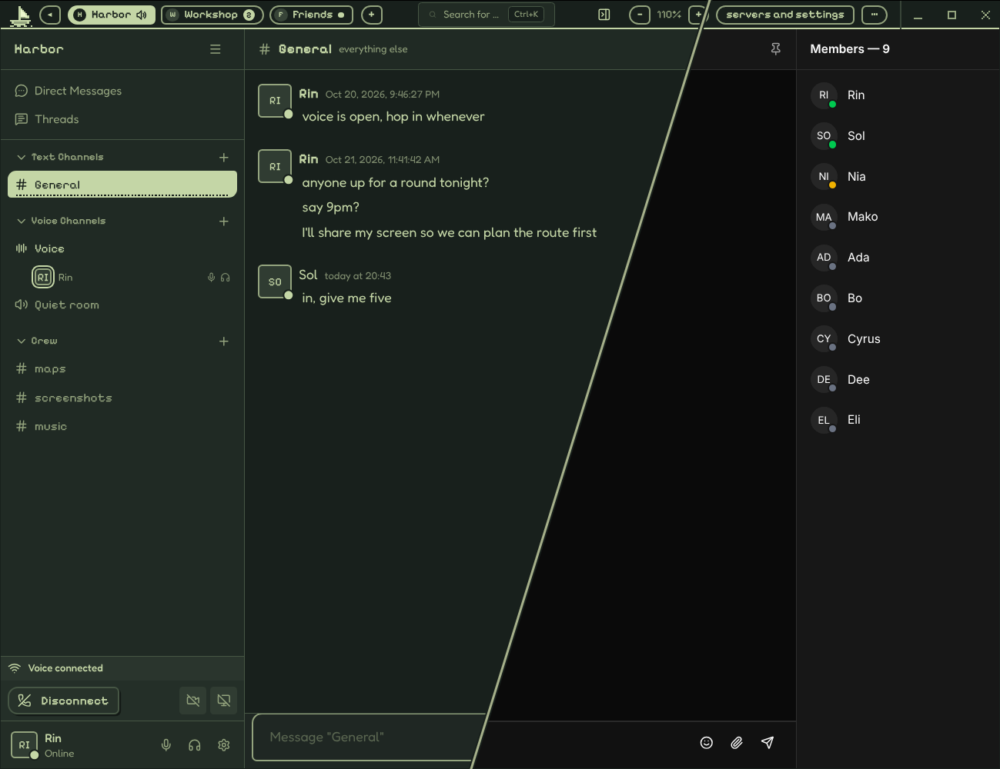
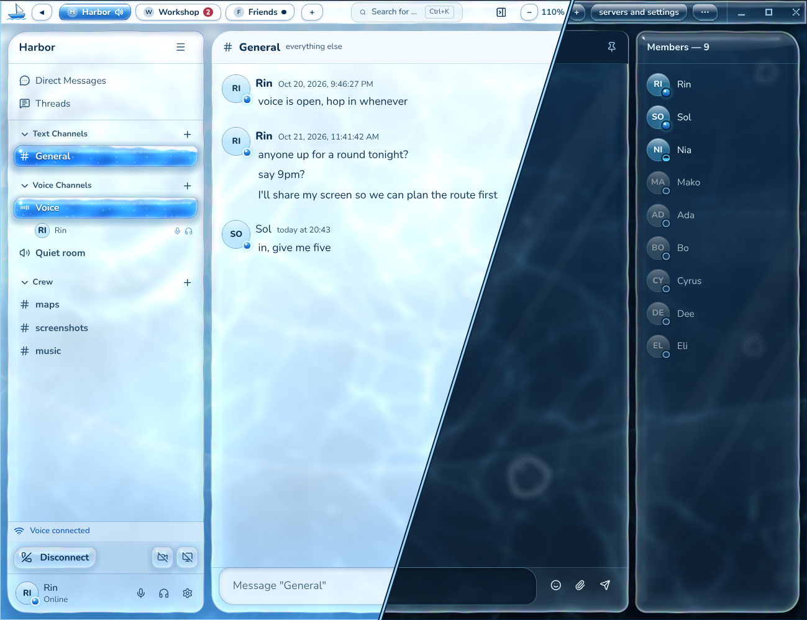
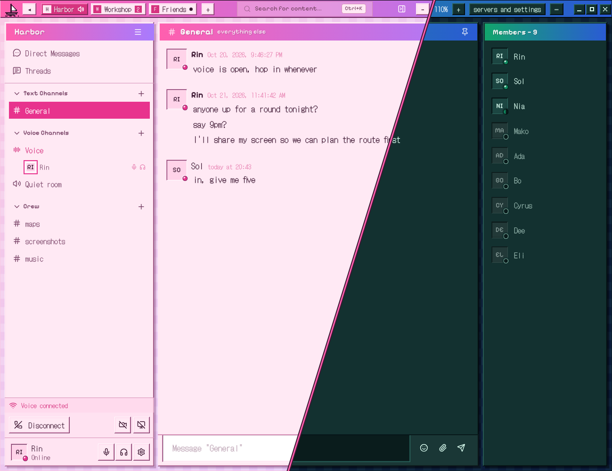
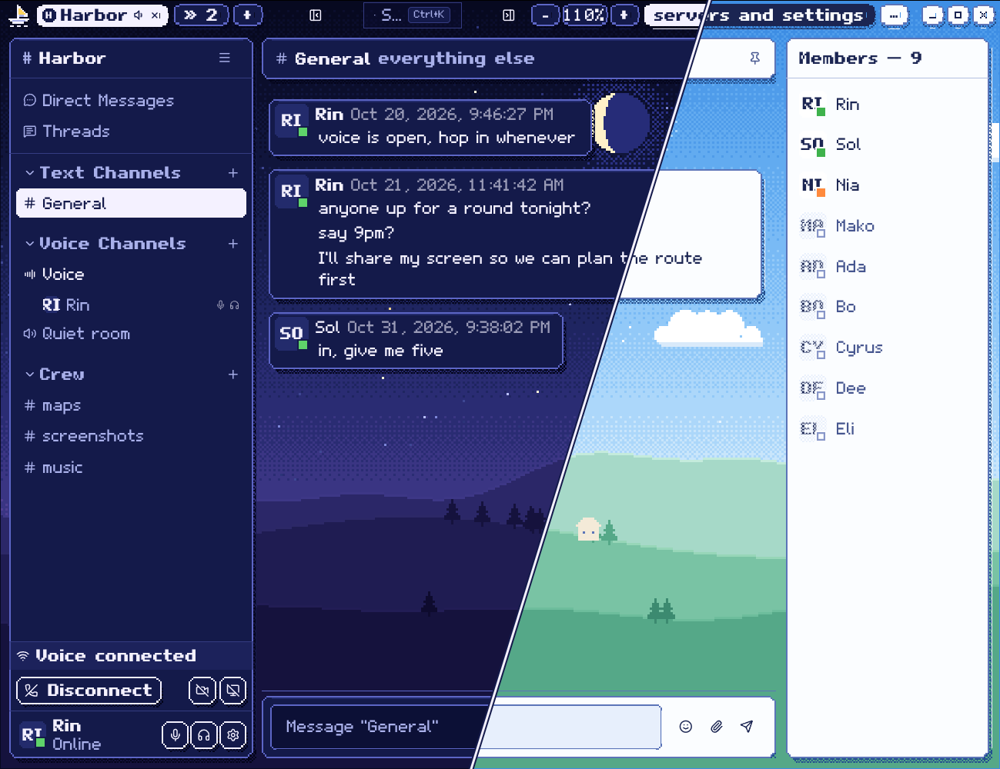
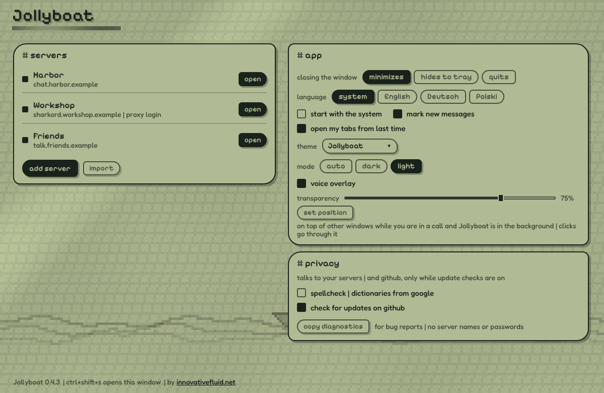

<p align="center"></p>

# Jollyboat

A desktop app for [Sharkord](https://sharkord.com) servers, for Windows, Linux and macOS. It loads your servers' own web app and adds what a browser tab can't: screen sharing with sound, global hotkeys and push-to-talk, servers in tabs, a tray, a voice overlay and themes. Not affiliated with Sharkord.



<sub>Three servers in tabs: in a call on Harbor, a mention waiting on Workshop, unread messages on Friends. The Jollyboat theme (left) and Sharkord's own look (right).</sub>

## What it adds

**In a call**
- **Screen sharing with sound** — everything you hear except your own call, just one app's sound (Windows 10 2004 and newer, Linux with PipeWire), or none: the share picker asks. On Linux the share is encoded on the GPU when it can be.
- **Global hotkeys and push-to-talk** — mute, deafen and push-to-talk from any window, set in Sharkord's user settings. Push-to-talk works on Windows and on Linux desktops with the shortcuts portal (KDE, GNOME 48+), where the desktop asks once.
- **Voice overlay** (optional) — who is in the call and who is talking, on top of your game or other apps, as see-through as you like. Clicks go through it.
- **Pop-out stream** — a screen share or camera someone sends, in its own small always-on-top window (ctrl+shift+p, or the button in the bar).
- **Careful in calls** — asks before a reload, a closed tab or quitting would drop you out of a call.

**Servers**
- **Tabs** — every server you open stays open in a tab, with its logo, a dot for unread messages (a count when you are mentioned) and a speaker while you are in a call there. Stay in a call on one server while you read another; the tray, the overlay and your hotkeys follow the call. ctrl+1–9 or ctrl+tab to switch, drag to reorder, **+** to open another, × to close. The tabs come back at the next start.
- **Sharkord's desktop mode** — servers on Sharkord 0.0.29 and newer run as in Sharkord's own desktop app: native notifications that open the right server and message, unread and mention counts, hotkeys without pairing. Older servers work as before.
- **Proxy logins** — servers behind a login page of their proxy (basic auth), staying logged in, invite links, and share codes that pass a server on to a friend with its proxy login and an invite.
- **Saving pictures and files** — a save button and a right-click menu; the app saves them itself, so it works behind a proxy login, where another browser couldn't open them.
- **sharkord:// links** — the "Add to desktop app" links under a server's login open Jollyboat's setup window with the server filled in.

**Around it**
- **One bar on top** — Sharkord's own top bar (search, member list, voice and plugin buttons) joins Jollyboat's bar: one row with your tabs on the left and zoom, settings and the window buttons on the right. At a big zoom in a small window they go back to two rows.
- **Tray** — in voice, talking, muted, deafened, new messages; its icon matches your theme.
- **Controllers for plugins** — game controllers reach the page (Flatpak too), and plugins like Jollyplay may light up a DualShock 4 or DualSense.
- **Light, dark or auto**, **English, German and Polish**, zoom per server.
- **Private** — talks to your servers, plus GitHub for update checks (one switch to turn off). No telemetry. On Windows, push-to-talk uses a keyboard hook while a hotkey is set: keys are compared with your hotkeys and never stored or sent. See the [privacy policy](PRIVACY.md).

## Jollyboat and Sharkord Desktop

Sharkord has its own desktop app now. Both load your servers' own web app; they differ around it:

| | Sharkord Desktop | Jollyboat |
|---|---|---|
| Made by | the Sharkord developers, in step with Sharkord | an independent project |
| Several servers | a server rail on the side | tabs in the title bar |
| Servers behind a proxy login (basic auth) | — | ✓ |
| Invite links, share codes | — | ✓ |
| Screen sharing with sound | ✓ | ✓, also one app's sound |
| Push-to-talk | Linux on Wayland | Windows, Linux with the shortcuts portal |
| Tray | unread marker | voice state, unread, mute and deafen from the menu |
| Voice overlay, pop-out stream | — | ✓ |
| Themes | — | Jollyboat, Water, Retro, Pixel Sky, your own CSS |
| Saving files behind a proxy login | — | ✓ |
| Installs | Windows, macOS, Linux AppImage | Windows (also portable, ARM), Linux Flatpak and AppImage (x64, ARM), macOS |
| Languages of the app itself | 8 | 3 |

A new Sharkord release can need a Jollyboat release before its desktop mode works there; until then such a server runs as in a browser, with everything above but the native notifications and counts.

## Themes

Pick one under **servers and settings**; Water and Retro come in a few colours, picked with the little squares beside the theme menu. The app's own windows (the bar, the setup window, the overlay) follow along, and each theme has its own tray icon.

- **Sharkord** — Sharkord as it is.
- **Jollyboat** — an lcd look: pixel type for headings, pill buttons, presence you can tell apart at a glance, a few stepped animations.
- **Water** — white and blue water under glass; or pink, or black and white. Live water with caustics, ripples and air bubbles runs behind everything; the sidebars, the chat and the bar are frosted glass floating on it, the buttons glass bubbles whose water leans toward the pointer, the channel you are on a pill of water. Sent messages drop into the water, and whoever talks sends rings across it. 60 frames a second in front, 30 behind, and it rests while a Jollyplay game is open; without hardware graphics a lighter version drawn in CSS.
- **Retro** — a nineties desktop, in pink, in mint and sky blue, or in the classic grey. The sidebars, the chat and the member list are windows with gradient title bars on a pastel desktop; bevelled buttons, sunken fields, old scrollbars, pixel type. Gradients are dithered bands, as a sixteen-colour screen drew them, and everything moves in whole steps: dialogs zoom open through dotted frames over a dithered dark, tooltips and toasts dissolve in, side panels slide in, menus unroll, a title bar glints when the pointer comes into its window, marching ants go round what is under the pointer, new messages print themselves in, and whoever talks gets a blinking frame.
- **Pixel Sky** — a calm sky over rolling hills, drawn on a real pixel grid: stars drift and twinkle, a shooting star crosses now and then, the moon shows tonight's real phase, and by day the sun is out with clouds. The chat is open sky with every group of messages on its own little panel; the sidebars and fields are pixel panels with stepped corners and dithered shadows, in one ink and the study's own 5 × 7 pixel type. Everything fades by dithering, never by blending. Night with dark mode, day with light. In the setup window Pebble the frog hangs out on the hill; click it.
- **Custom** — your own CSS for the Sharkord page, read again whenever the file changes.



<sub>Water, light (left) and dark (right).</sub>



<sub>Retro in pink, light (left), and in green, dark (right).</sub>



<sub>Pixel Sky, night (left) and day (right).</sub>

## Install

From [releases](../../releases):

| | |
|---|---|
| Windows (x64 or ARM) | `Jollyboat-x.y.z-windows-universal-setup.exe`, updates itself; or portable: `Jollyboat-x.y.z-windows-x64-portable.exe` (`arm64`), settings in a `Jollyboat-data` folder next to it, updates itself too |
| Linux (x64 or ARM) | the AppImage, which updates itself: `Jollyboat-x.y.z-linux-x86_64.AppImage` (`arm64`), make it executable and run it once, it adds itself to the app menu; or `flatpak install ./Jollyboat-x.y.z-linux-x64.flatpak` (`arm64`) |
| macOS 13+ (Intel or Apple silicon) | `Jollyboat-x.y.z-mac-universal.dmg`. It is not signed by Apple: open it the first time with **System Settings → Privacy & Security → Open Anyway**. It tells you about new releases instead of updating itself |

Add your server's address; if a proxy asks for a login first, tick **proxy login / basic auth**. **servers and settings** in the bar (or ctrl+shift+s) opens the settings again, and **+** opens another server in a tab.



Tip: for GPU-encoded screen shares, pick H264 (or AV1 on newer GPUs) as the screen codec in Sharkord's settings, with simulcast off.

## Build

```bash
npm install
npm run dev
npm run dist:win       # on Windows: the installer and both portable exes
npm run dist:appimage  # the AppImage; the flatpak is built from source:
                       # flatpak-builder --user --install build-dir flatpak/net.innovativefluid.Jollyboat.yml
npm run dist:mac       # on a mac
python3 tools/make-icons.py   # the app and tray icons, from build/pixel/ (needs Pillow)
```

## Code signing policy

Free code signing provided by [SignPath.io](https://signpath.io), certificate by [SignPath Foundation](https://signpath.org).

The Windows downloads (the installer and the portable exes) are signed from the first release after the project's application to the SignPath Foundation is accepted; earlier releases are unsigned. Only builds made by this repository's GitHub Actions release workflow from its public source are signed, and each release is approved by hand before it is signed.

- Committers and reviewers: [innovativefluid](https://github.com/innovativefluid)
- Approvers: [innovativefluid](https://github.com/innovativefluid)

Privacy: Jollyboat sends nothing to anyone but the servers you add, and GitHub for update checks while those are on. See the [privacy policy](PRIVACY.md).

## License

MIT — see [LICENSE](LICENSE) and [THIRD_PARTY_NOTICES.md](THIRD_PARTY_NOTICES.md).
